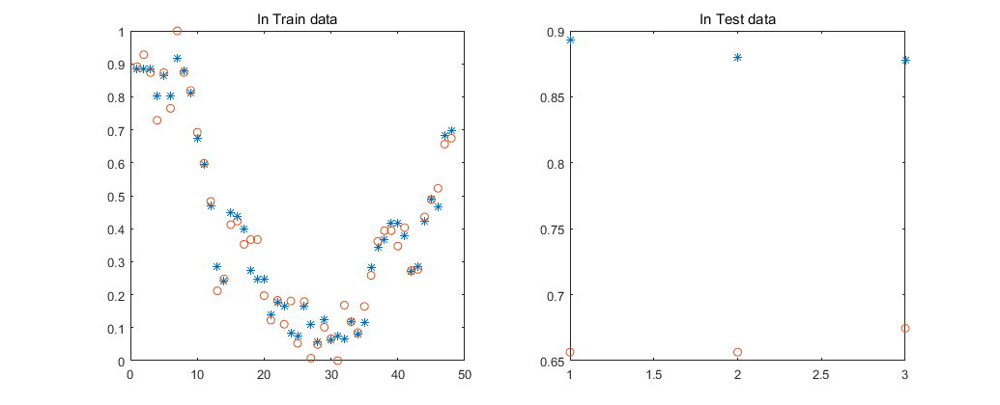
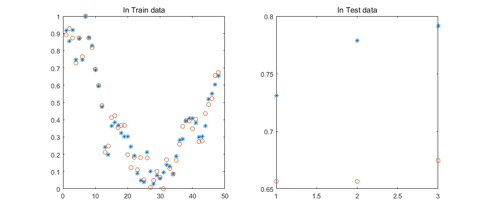
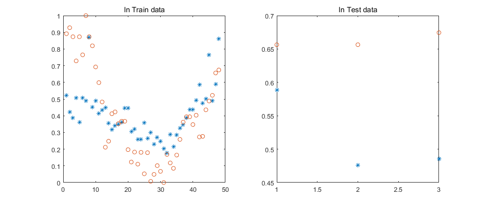
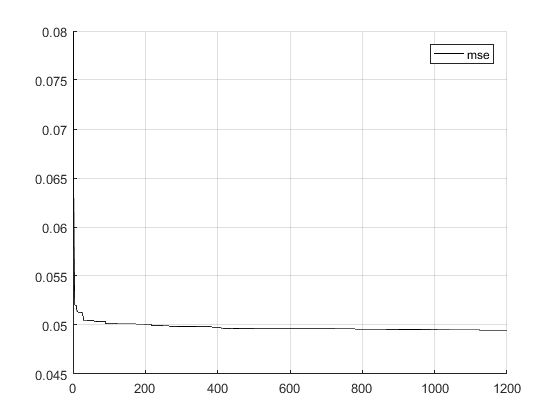

# BP-RBF-Prediction

MATLAB implementations for time-series / tabular prediction using three neural-network approaches:

- **BP Neural Network** (`BP.m`)
- **RBF Neural Network** (`RBF.m`)
- **PSO-optimized RBF Neural Network** (`RBFPSO.m`)

The repository includes a small example dataset and scripts for training, testing, visualization, and error calculation.

## Overview

The example data have shape **52 × 4**. The scripts use the first 48 samples for training and the last 3 samples for testing, with one-step-ahead prediction for a selected feature.

The variable `num` controls which of the four features is used as the prediction target:

```matlab
num = 1; % predict feature 1
num = 2; % predict feature 2
num = 3; % predict feature 3
num = 4; % predict feature 4
```

Use the same meaning of `num` in BP, RBF, and PSO-RBF experiments when comparing the methods.

## Files

| File | Description |
| --- | --- |
| `BP.m` | Back-propagation neural network baseline |
| `RBF.m` | Radial basis function neural network baseline |
| `RBFPSO.m` | RBF network whose parameters are optimized with particle swarm optimization |
| `data.mat` | Example MATLAB dataset |
| `data.xlsx` | Example data in spreadsheet format |
| `img-folder/` | Example output figures |

## Requirements

- MATLAB
- Neural Network / Deep Learning Toolbox functions used by the scripts, including `mapminmax`, `newff`, `newrb`, `sim`, `dist`, and `radbas`

Because some of these APIs are legacy MATLAB neural-network functions, behavior may vary across MATLAB releases.

## Usage

Clone the repository and open it in MATLAB. Run one of the three scripts directly:

```matlab
BP
RBF
RBFPSO
```

The scripts load `data.mat`, normalize the data, train the selected model, predict on the training and test samples, and report prediction errors.

To predict another feature, change `num` to a value from `1` to `4` before running the script.

## Notes on PSO-RBF

`RBFPSO.m` uses stochastic particle initialization, so results can vary between runs. A PSO-optimized model is **not guaranteed** to outperform the BP or standard RBF baseline on every run or every target feature. For fair comparison, keep the target feature and data split fixed and consider repeated runs with controlled random seeds.

The PSO fitness calculation is kept consistently in **RMSE** form during initialization and optimization.

## Example Results

### BP



### RBF



### PSO-RBF



### Optimization loss



## Maintenance

This repository is maintained as a compact educational and reproducibility example. Bug reports, compatibility fixes, documentation improvements, and reproducibility-related contributions are welcome through GitHub Issues and Pull Requests.

---

## 中文说明

本项目使用 MATLAB 实现 BP 神经网络、RBF 神经网络以及 PSO 优化的 RBF 神经网络进行预测。

示例数据大小为 **52 × 4**。代码将数据划分为训练集和测试集，并通过 `num = 1, 2, 3, 4` 选择需要预测的目标特征。为了公平比较三种方法，请在不同脚本中保持相同的 `num` 设置和数据划分。

PSO-RBF 包含随机初始化，因此不同运行之间的结果可能存在波动；PSO 优化也不保证在每个目标特征和每次运行中都优于普通 BP 或 RBF。
